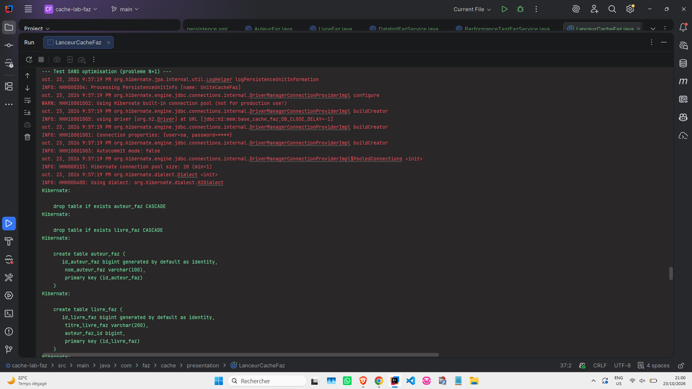
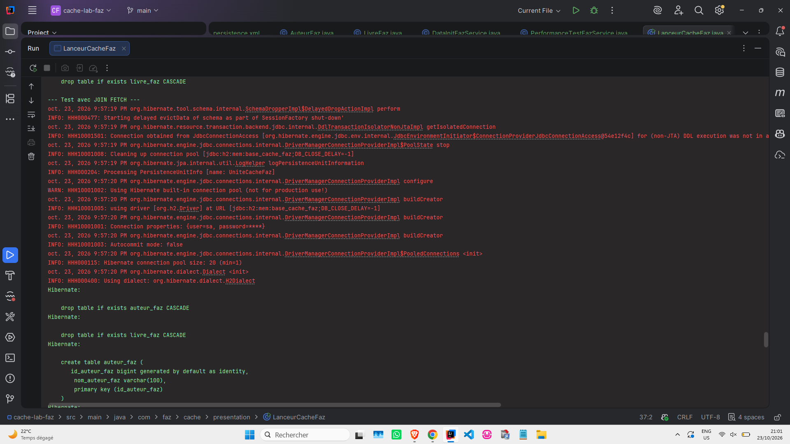
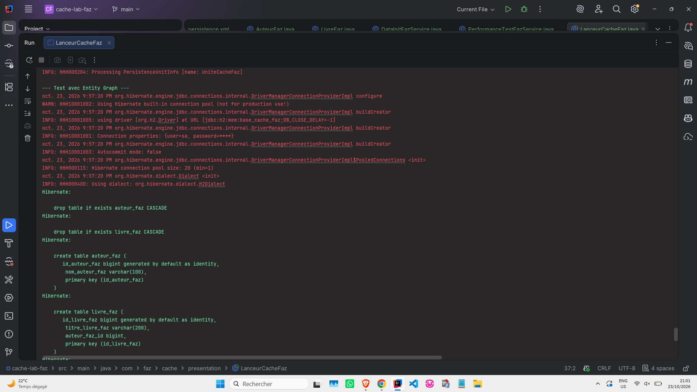

# Cache Lab - Optimisation des requêtes JPA (Faz)

Projet Java JPA/Hibernate démontrant le problème N+1 et ses solutions avec `JOIN FETCH` et les `Entity Graphs`.

## 🎯 Objectifs

- Identifier le problème N+1
- Optimiser les requêtes avec `JOIN FETCH`
- Optimiser les requêtes avec les `Entity Graphs`

## 📊 Résultats des tests

| Test | Temps | Requêtes SQL |
| :--- | :--- | :--- |
| **Sans optimisation (N+1)** | 166 ms | 11 requêtes |
| **Avec JOIN FETCH** | 21 ms | 1 requête |
| **Avec Entity Graph** | 12 ms | 1 requête |

## 📸 Captures d'écran

### 1. Test sans optimisation (problème N+1)
*11 requêtes SQL sont générées pour charger 10 auteurs et leurs 50 livres.*

---

### 2. Test avec JOIN FETCH
*Une seule requête SQL avec `INNER JOIN`.*

---

### 3. Test avec Entity Graph
*Une seule requête SQL avec `LEFT OUTER JOIN`, sans modifier le JPQL.*

## 🛠️ Technologies

- Java 23
- Hibernate 5.6.15.Final
- JPA 2.2
- H2 (base en mémoire)

## 👤 Auteur

**Fatima Zahra Ait Boutargante**
- GitHub : [@AitBoutarganteFatimaZohra](https://github.com/AitBoutarganteFatimaZohra)